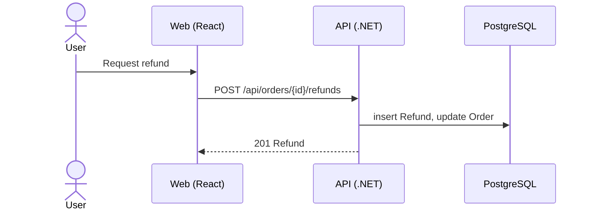

# Feature docs

Every finished feature gets a walkthrough a teammate can read to understand **what it does, how
it works, and how its code and services fit together**, without reading the code first or asking
the author. The pipeline record (`docs/pipeline/<slug>/`) explains how the work was decided; the
feature doc explains the result, and stays true as the code changes.

## When

- **A new feature is finished**: write `docs/features/<feature>.md`. In `/dev-pipeline` this happens
  in the QA handoff, before `phase: "done"`.
- **A documented feature changes behaviour, contracts, data or config**: update its doc in the same
  change, and add a line to its Changelog.
- **A small fix that changes no behaviour**: no doc change needed.
- **Documenting existing code** ("explain how X works"): same template, built by reading the code.
  Load `fullstack-dev-skills:spec-miner` for undocumented legacy code.

## Where

```
docs/
  features/
    README.md            index: one line per feature → its doc, status, owner area
    <feature>.md         one file per feature, kebab-case, named for what users call it
  CONTEXT.md             its Features index links each feature to its doc
```

Create `docs/features/README.md` with the first doc. Keep both indexes in sync.

## Template

Write it for a developer joining the team, and keep the top readable for a product or QA person.
Every section is required; one that doesn't apply says why in one line.

````markdown
# <Feature name>

> One or two sentences: what it does and for whom.

**Status:** shipped | beta | behind flag `<name>` · **Owner area:** <folder / module> ·
**Last updated:** <yyyy-mm-dd>

## What it does
The user-visible behaviour in plain language: who can use it, what they can do, the rules and
limits (e.g. "refunds are allowed within 30 days of delivery, once per order").

## Walkthrough
The main flow, step by step, from the user's action to the result. Name what happens at each
layer, with links to the code:
1. The user clicks **Request refund** on the order page
   ([OrderDetails.tsx](../../web/src/orders/OrderDetails.tsx)).
2. The client calls `POST /api/orders/{id}/refunds` through `ordersApi.requestRefund`
   ([ordersApi.ts](../../web/src/api/ordersApi.ts)).
3. …
Then the important alternate flows: failure, empty, permission denied, retry.

## How it fits together
A Mermaid diagram of the components and calls involved (sequence diagram for a flow, flowchart
for structure). Keep it to the pieces this feature touches.



## Code walkthrough
Layer by layer, in the order a request flows. For each important file: what it's responsible for,
the key functions / components / classes and what each does, and the non-obvious decisions (why
it's done this way). Link files and lines. Short excerpts only where they make the logic clearer.
- **UI**: components, state, data fetching and cache invalidation
- **API**: routes / controllers, request and response DTOs, validation, authorization
- **Domain / services**: the business rules and where they live
- **Data**: repositories / queries, transactions
- **Background work**: jobs, queues, schedules, webhooks

## Services and dependencies
| Service | Used for | Where in code | Config / env |
|---|---|---|---|
| PostgreSQL | stores refunds | `RefundRepository` | `ConnectionStrings__Default` |
| <External API> | <purpose>, auth method, rate limits | <adapter file> | `<ENV_VAR>` |

## Data
Tables / models / collections added or used, their key fields, relations, indexes, and the
migration that created them. What is stored, for how long, and anything personal or sensitive.

## API and contracts
Each endpoint, event or public type: method and path, who may call it, request and response
shapes, status codes and error shapes. Link the OpenAPI spec or Postman collection if one exists.

## Configuration
Every env var, config key and feature flag that changes behaviour, its default, and the file it's
declared in. Never real secret values.

## Errors and edge cases
What happens on invalid input, unauthorized access, external service failure or timeout,
concurrent edits and retries, and what the user sees in each case.

## Testing
Where the tests are and what they cover; how to run them; how to try the feature by hand
(seed data, test accounts, sandbox keys), step by step.

## Extending it
How to add the next case (a new refund reason, a new provider): which files to touch, in order.
What to keep in mind so it doesn't break.

## Known limitations and follow-ups
What it deliberately doesn't do yet, known issues, and planned improvements.

## Changelog
- <yyyy-mm-dd> — Created (<pipeline slug or PR link>)
````

## Rules

- **True to the code.** Write the doc from the final code, not from the plan. Open each file you
  describe and link real paths and line numbers (relative links from the doc's folder). If the plan
  and the code disagree, the code wins and the doc says what it does.
- **Explain, don't transcribe.** Say why things work the way they do and how the pieces connect.
  Don't paste whole files or restate every line.
- **Plain, specific language.** Short sentences, the project's glossary terms, no marketing words.
  The `review-ready-code` rules about tone apply here too.
- **Diagrams must render.** Mermaid only (GitHub and VS Code render it). Check the syntax.
- **No secrets, tokens or personal data** in examples. Use obviously fake placeholders.
- **Link both ways**: the doc links the code, the CONTEXT.md features index and
  `docs/features/README.md` link the doc, and the pipeline record's `log.md` links it.
- After writing, re-read the doc once as a newcomer would: could they find the entry point,
  follow the main flow and know where to make the next change?

## Handoff

When you finish a feature, tell the user in two or three plain sentences how it works, then link
the doc. The detail lives in the doc, not in the chat.
