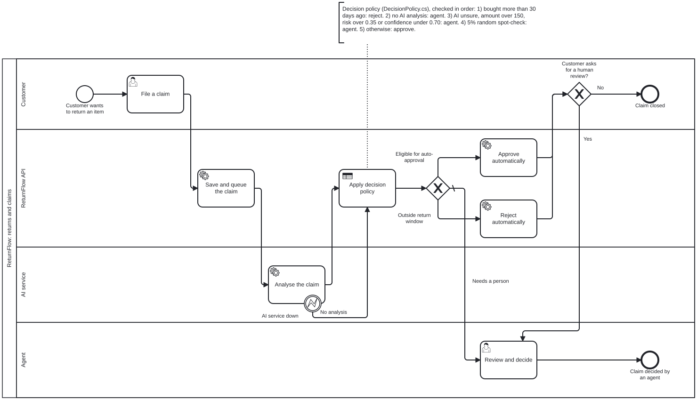
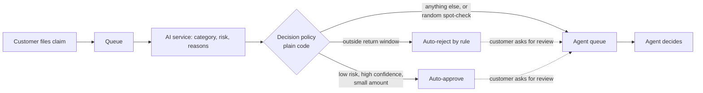

# ReturnFlow

Returns and claims management where **AI advises, rules decide, and a person steps in when asked**.

Customers file a claim. A Python service analyzes it in seconds (category, risk, reasons). A plain-code policy then either settles it automatically or sends it to an agent. Customers can always ask for a human review, and managers see live KPIs for D1, D7 and lifetime.

| Part | Folder | Stack |
|---|---|---|
| Web and mobile app (installable PWA) | `returnflow-web` | React, TypeScript, Vite, Tailwind, TanStack Query, Recharts |
| REST API, policy, KPIs, background worker | `returnflow-api` | C# / .NET 10, ASP.NET Core, EF Core, PostgreSQL, JWT |
| AI claim analysis | `returnflow-ai` | Python, FastAPI, scikit-learn |

## Quick start

Requirements: Docker Desktop.

```bash
docker compose up --build
```

Open **http://localhost:8080**. On the login page, tap **Customer**, **Agent** or **Manager** to sign in with one tap (demo mode).

To open it on your phone, see [docs/PHONE_ACCESS.md](docs/PHONE_ACCESS.md).

### Five-minute demo script

1. **Customer:** tap *New return*, describe a clear problem ("The screen arrived cracked", amount 60). The AI analyzes it and the claim is approved automatically within seconds.
2. **Customer:** file another claim with a purchase date 45 days ago. The return-window rule rejects it automatically. Open it and tap **Ask for a human review**.
3. **Agent:** the review queue now shows that claim with the AI's risk score and reasons. Approve or reject it with a comment.
4. **Manager:** open **KPIs** and switch between **D1**, **D7** and **Lifetime**. The recap summarizes automation rate, AI vs human decisions, review requests, speed and backlog.

## Process model (BPMN)

The returns process is modelled in BPMN 2.0, with the same rules and the same order as
`DecisionPolicy.cs`. Open [docs/bpmn/returns-process.bpmn](docs/bpmn/returns-process.bpmn)
in [Camunda Modeler](https://camunda.com/download/modeler/) or at [demo.bpmn.io](https://demo.bpmn.io) to edit it.



## How a claim flows



- The **AI never decides alone.** It returns a category, a risk score, a confidence, and reasons. It can recommend approval or ask for a human, but it never rejects.
- The **policy** (`DecisionPolicy.cs`) is deterministic and unit-tested. Thresholds live in `appsettings.json` under `Policy`.
- A small share of would-be auto-approvals (`SpotCheckRate`, 5%) goes to a person anyway, to measure the AI's accuracy.
- If the AI service is down, claims go to an agent instead of failing.
- Customer text is treated as untrusted data. The model maps text to a label and never follows instructions inside it.
- Everything is written to an audit log.

## KPIs

`GET /api/stats?range=d1|d7|lifetime` (managers and admins). Each range is compared with the previous period of the same length (D1 vs the day before, D7 vs the week before).

| KPI | Meaning |
|---|---|
| Claims processed | Decisions made in the period (a claim sent back for review counts twice) |
| Automation rate | Share of decisions made with no human involved |
| Decided by AI + policy / by agents | The split between automatic and human decisions |
| Human reviews requested | Times a customer or staff member asked for a person |
| Approval rate, approved amount | Outcomes of the decisions |
| Time to decision | Average from filing to decision, automatic vs human |
| Backlog | Claims waiting for an agent or for the AI right now |

## The AI model, honestly

The model is trained on **synthetic data**, so the pipeline works end to end without real customer data. `returnflow-ai/models/metrics.json` is written at build time and shown at `GET /model-info` on the AI service.

- The category classifier is evaluated on templates held out from training to reduce duplicate-phrase leakage. Its score is still only a synthetic-data measure, not a real-world accuracy figure.
- The risk model is a logistic regression with explainable reasons. Its labels come from a hidden rule plus noise, so its metrics only prove the pipeline works.
- The default automatic-approval risk limit is 0.35; model metrics report risk precision and recall at that same limit. This slightly widens automation while preserving the amount cap, confidence gate, and 5% spot-check.
- Before any real use: replace the synthetic data with real labelled claims, re-evaluate, and re-tune the policy thresholds.

## Configuration

| Setting | Where | Default |
|---|---|---|
| `Policy:*` (window, amount limit, risk, confidence, spot-check, on/off switch) | `appsettings.json` | 30 days, 150, 0.35, 0.70, 5%, on |
| `Ai:BaseUrl` | env `Ai__BaseUrl` | `http://ai:8000/` in Docker |
| `JWT_KEY`, `DEMO_MODE`, `DEMO_PASSWORD` | `.env` (copy `.env.example`) | demo values |

Set `Policy:AutomationEnabled` to `false` and every claim goes to an agent.

## Development without Docker

```bash
# database only
docker compose -f returnflow-api/docker-compose.yml up -d db

# AI service
cd returnflow-ai && python -m venv .venv && . .venv/bin/activate   # Windows: .venv\Scripts\activate
pip install -r requirements-dev.txt && pytest && uvicorn app.main:app --port 8000

# API (new terminal): http://localhost:5080, docs at /scalar
cd returnflow-api && dotnet test && dotnet run --project src/ReturnFlow.Api

# Web (new terminal): http://localhost:5173, forwards /api to the API
cd returnflow-web && npm install && npm run dev
```

## Known limits

- The queue between API and AI is in memory. Replace it with RabbitMQ or Redis streams to scale out.
- The schema is created automatically on first run. Add EF Core migrations (`dotnet ef migrations add ...`) before a real deployment, and they will be applied instead.
- Photo upload for claims and a push-notification channel are not built yet.
- The web app is an installable PWA shell without offline support. Phones need HTTPS to install it.

See [docs/TECH_CHOICES.md](docs/TECH_CHOICES.md) for why this stack was chosen.

## License

MIT
