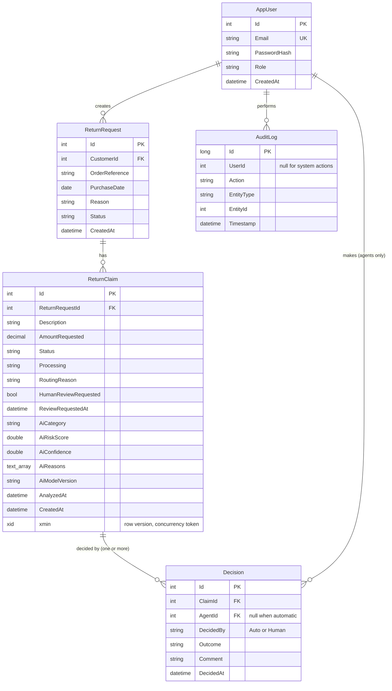

# Data model

## Claim workflow (`Processing`)

`Analyzing` -> `AutoDecided` or `NeedsHuman`
`AutoDecided` -> `HumanReviewRequested` (customer or staff asks) -> `HumanDecided`
`NeedsHuman` -> `HumanDecided`

## Business rules

- A customer can only see and extend their own returns.
- A claim starts `Open` and can be decided only while open. A human review reopens an automatically decided claim and keeps the earlier decision in the history.
- Only `Agent`, `Manager` and `Admin` can decide claims; only `Manager` and `Admin` can read statistics.
- The AI recommends; `DecisionPolicy` decides whether a claim is handled automatically.
